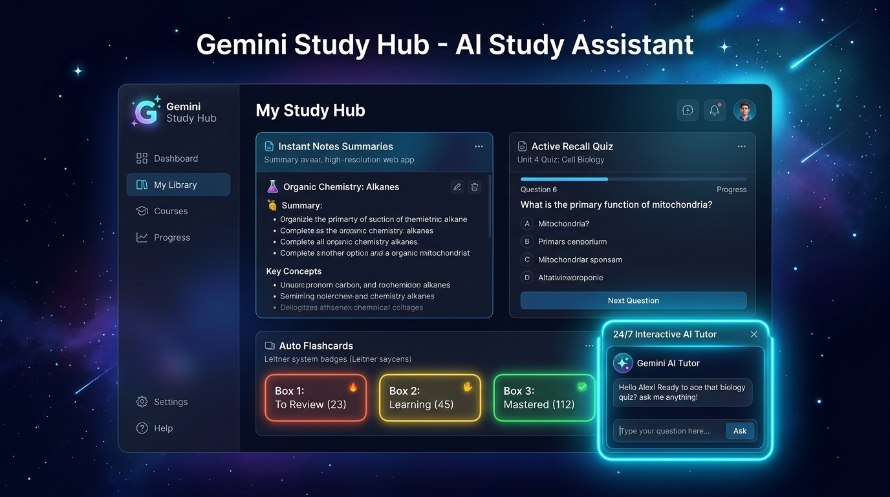
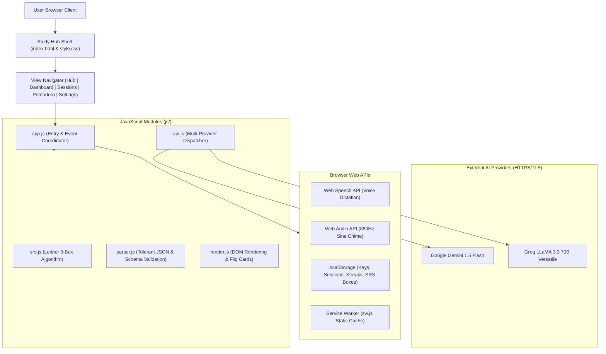

# 🧠 Gemini Study Hub — AI Study Assistant

<div align="center">



### 🌐 **Live Web App:** [https://ai-study-assitance.netlify.app](https://ai-study-assitance.netlify.app)

[](https://ai-study-assitance.netlify.app)
[](https://github.com/Krishna9423-wagh/AI-Study-Assistant)
[](https://github.com/Krishna9423-wagh/AI-Study-Assistant)
[](https://github.com/Krishna9423-wagh/AI-Study-Assistant)
[](https://github.com/Krishna9423-wagh/AI-Study-Assistant)
[](LICENSE)

> 🚀 **Direct Access:** Experience the live app instantly in your browser without any setup:  
> 👉 **[Open Gemini Study Hub on Netlify](https://ai-study-assitance.netlify.app)**

**An ultra-modern, privacy-first, zero-dependency AI Study Hub that transforms lecture notes, textbook chapters, and conceptual topics into executive summaries, Leitner spaced-repetition flashcards, active recall quizzes, and interactive 24/7 tutor conversations.**

[⚡ Open Live App](https://ai-study-assitance.netlify.app) • [Key Features](#-key-features) • [Architecture](#-architecture) • [Getting Started](#-getting-started) • [Keyboard Shortcuts](#-keyboard-shortcuts) • [Viva & Academic Defense](#-viva--academic-defense)

</div>

---

## 🌟 Overview

**Gemini Study Hub** is an offline-ready, responsive pair-learning platform crafted entirely with **vanilla web technologies (HTML5, modern CSS3, and ES6+ JavaScript)** — strictly without frameworks, bundlers, or third-party npm runtime dependencies.

It pairs active learning principles with generative AI, featuring:
1. **Multi-Provider AI Core:** Switch between **Google Gemini 1.5 Flash** and **Groq LLaMA 3.3 70B** with a single click.
2. **24/7 Interactive AI Tutor:** A persistent, docked floating chat widget that provides follow-up explanations, real-world analogies, and answers based on your active study notes.
3. **Leitner 3-Box Spaced Repetition (SRS):** Scientifically verified card consolidation moving cards between Box 1 (frequent review), Box 2 (intermediate), and Box 3 (mastered).
4. **Active Recall Practice Quizzes:** Timed 30-second countdowns, detailed conceptual explanations for every option, and a dedicated "Review Mistakes" retry mode.
5. **Focus & Pomodoro Timer:** 25-minute focus intervals and 5-minute cognitive breaks with an SVG progress ring and a native **Web Audio API** chime.

---

## ✨ Key Features

### 1. 💬 24/7 Interactive AI Tutor
- Docked floating trigger pill that expands into a glassmorphic chat window.
- Quick prompt chips (*"Explain wave-particle duality"*, *"Quantum tunneling example"*, *"What is Planck's constant?"*).
- Formats markdown bolding, lists, and mathematical equations with zero external markdown libraries.
- Features an intelligent, contextual offline fallback tutor for zero-downtime presentations and viva demonstrations.

### 2. 🔄 Leitner 3-Box Spaced Repetition System (`js/srs.js`)
- Algorithmic Leitner box allocation based on performance:
  - **Box 1:** Difficult / new cards (reviewed most frequently).
  - **Box 2:** Moderate retention cards.
  - **Box 3:** Mastered cards.
- Marking **"Known"** promotes cards ($1 \rightarrow 2 \rightarrow 3$).
- Marking **"Not known"** drops the card back to Box 1 for reinforcement.
- **Weighted Review Session:** Assembles a targeted session drawn by cognitive need (60% Box 1, 30% Box 2, 10% Box 3).

### 3. 🎯 Active Recall Quiz & Conceptual Feedback
- Multiple-choice assessment generated at 5, 10, or 15 questions across Easy, Medium, or Hard difficulty.
- Immediate one-line explanation feedback revealed after selecting an answer.
- **Optional Timed Mode:** 30-second countdown bar that shifts from theme accent to danger red in the final 5 seconds.
- **Leak-Proof Timer Lifecycle:** Automatically halts and cleans up timer loops when leaving the tab or page (`visibilitychange`, `pagehide`).
- **Review Mistakes & Retry:** Filters to missed questions and lets the user retry only the wrong questions.

### 4. ⏳ Focus / Pomodoro Timer
- 25m Focus and 5m Break modes with state toggles (Start, Pause, Resume, Reset).
- Circular SVG progress ring with synchronized countdown digits.
- Synthetic 880Hz sine oscillator chime generated via **Web Audio API** (no audio assets required).

### 5. 🎙️ Voice Dictation & Text File Upload
- Dictate study notes hands-free via the **Web Speech API** (`webkitSpeechRecognition`).
- Real-time animated pulsing recording state and permission handling.
- Drag or upload plain text (`.txt`) lecture notes with automatic limit checking (8,000 char threshold).

### 6. 🗂️ Conceptual Hierarchical Outline
- Native collapsible `<details><summary>` tree grouping core concepts, sub-principles, and formulas.
- "Expand All" and "Collapse All" shortcuts for fast scanning.

### 7. 📊 Performance Analytics & Daily Streaks
- Tracks daily study activity with consecutive streak counter (`🔥 Day Streak`).
- Chronological score accuracy plotted on a **pure CSS bar chart** (no Chart.js or canvas libraries).
- Tracks quizzes completed, average accuracy percentage, and Leitner cards in Box 3.

### 8. 🎨 Design System & Customization
- **Theme Support:** Instant Dark Mode and Light Mode switching with zero flash-of-unstyled-content.
- **5 Accent Color Palettes:** Gemini Blue, Electric Indigo, Emerald Green, Solar Amber, and Radiant Rose.
- Fully responsive across desktop (1280px+), tablet (768px - 1024px), and mobile (360px - 480px).

### 9. 📥 Multi-Format Study Pack Exports
- **Print View:** Dedicated `@media print` stylesheet formatted cleanly for paper and PDF export.
- **CSV Flashcards:** Export flashcard decks ready for import into Anki or Quizlet.
- **JSON & TXT:** Download complete structured study kits.

---

## 🏛️ Architecture & System Design



### Module Responsibilities

| File | Purpose |
| :--- | :--- |
| [`index.html`](index.html) | Semantic HTML5 structure, navigation sidebar, view panels, and floating tutor widget. |
| [`css/style.css`](css/style.css) | Custom CSS design system, glassmorphism, accent palettes, 3D card flips, and 360px/768px/1280px responsive rules. |
| [`js/api.js`](js/api.js) | Multi-provider API abstraction layer for Google Gemini and Groq with custom prompt generation. |
| [`js/srs.js`](js/srs.js) | Pure Leitner 3-box spaced repetition engine (promotion, demotion, weighted session building). |
| [`js/storage.js`](js/storage.js) | Local browser persistence for API keys, user settings, drafts, streaks, and quiz analytics. |
| [`js/parser.js`](js/parser.js) | Fault-tolerant JSON parser with markdown block stripping and comprehensive schema validation. |
| [`js/render.js`](js/render.js) | DOM renderer for summaries, interactive quizzes, flashcards, outline trees, and dashboard bar charts. |
| [`js/app.js`](js/app.js) | Application lifecycle coordinator, event wiring, hotkeys, tutor chat, Pomodoro, and dictation. |
| [`sw.js`](sw.js) | PWA Service Worker caching static shell files while bypassing dynamic AI network endpoints. |

---

## 🚀 Getting Started

### Prerequisites
- Modern web browser (Google Chrome, Microsoft Edge, Mozilla Firefox, or Safari).
- *(Optional)* A Google Gemini API key or Groq API key for live generation. *(The application includes a pre-loaded Quantum Mechanics kit and offline tutor fallback for offline use!)*

### 🚀 Live Cloud Deployment (Zero Setup)
Open the fully functional deployed web app directly:
- **Production URL:** [https://ai-study-assitance.netlify.app](https://ai-study-assitance.netlify.app)

### Running Locally
Because Gemini Study Hub is built with vanilla web standards, no `npm install` or compilation step is needed:

1. **Clone the repository:**
   ```bash
   git clone https://github.com/Krishna9423-wagh/AI-Study-Assistant.git
   cd AI-Study-Assistant
   ```

2. **Serve with any local static HTTP server:**
   ```bash
   # Using Python 3
   python3 -m http.server 8123

   # Or using Node http-server / npx
   npx serve .
   ```

3. **Open in your browser:**
   ```
   http://localhost:8123/
   ```

4. **Configure your API Key:**
   - Click the **Settings** icon on the top-right or left navigation bar.
   - Choose your provider (**Google Gemini** or **Groq**).
   - Paste your API key and click **Save Settings** *(keys are saved strictly to your personal browser localStorage)*.

### Authentication setup (required before deployment)

The app now blocks all study screens until a user signs in with either a phone SMS code or an email one-time code. It uses [Supabase Auth](https://supabase.com/docs/guides/auth) so verification happens on a secure server rather than in the browser.

1. Create a Supabase project and open **Project Settings → API**.
2. Copy the project URL and the **anon/public** key into `js/auth-config.js`. Do not use or publish a `service_role` key.
3. In **Authentication → Providers**, enable Email and Phone.
4. Configure an SMS provider in Supabase (such as Twilio, MessageBird, or Vonage) and set its credentials in Supabase—not in this repository.
5. In **Authentication → Email Templates**, change the email confirmation template to include `{{ .Token }}` so users receive a code, rather than only `{{ .ConfirmationURL }}` magic link.
6. In **Authentication → URL Configuration**, add your production Netlify URL and local URL, for example `http://localhost:8123`.

Test phone and email sign-in on Safari and Chrome on both an iPhone and macOS. The code input supports iOS SMS autofill through `autocomplete="one-time-code"` and supports pasting the full code.

---

## ⌨️ Keyboard Shortcuts

| Shortcut | Action | Context |
| :--- | :--- | :--- |
| <kbd>Ctrl</kbd> + <kbd>Enter</kbd> / <kbd>⌘</kbd> + <kbd>Enter</kbd> | Generate Study Kit | Anywhere in Study Hub |
| <kbd>Space</kbd> | Flip active flashcard (Front / Back) | Flashcards Tab |
| <kbd>1</kbd> &ndash; <kbd>4</kbd> | Select Quiz Option (A, B, C, D) | Quiz Tab |
| <kbd>?</kbd> | Toggle Keyboard Shortcuts Modal | Global |
| <kbd>Esc</kbd> | Dismiss open dialogs, settings, and tutor window | Global |

---

## 🔒 Security & Privacy Notice

- **No Hardcoded Keys:** Zero API keys or secrets are stored in this codebase.
- **Client-Side Privacy:** Your study notes, generated materials, and API credentials never pass through an intermediary server. They are sent directly from your browser to Google / Groq over TLS/HTTPS.
- **No Third-Party Trackers:** Zero analytics trackers, cookies, or external ad scripts.

---

## 🎓 Viva & Academic Defense

If presenting this project for an academic evaluation, viva, or interview, consult the complete defense documentation:
- 📖 **[Viva Defense & Examiner Q&A Guide](viva_defense_guide.md)** — Explaining architecture decisions, vanilla vs. framework tradeoffs, Leitner algorithm math, memory leak prevention, and rate-limit mitigation strategies.

---

## 📄 License

This project is licensed under the [MIT License](LICENSE) — feel free to use, modify, and extend it for your own study needs.
