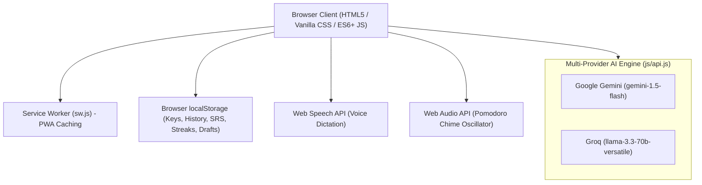

# AI Study Assistant - Project Audit & Viva Defense Guide

> [!NOTE]
> This guide is prepared for academic defense, viva examinations, and live technical demonstrations of the **AI Study Assistant (Study Hub)**.

---

## 1. System Architecture & Tech Stack



### Core Architecture Principles
1. **Zero External Dependencies / Pure Vanilla Architecture:**
   - Strictly built with standard HTML5, CSS3, and modern vanilla JavaScript.
   - No npm dependencies, no heavy frameworks (React/Vue/Angular), and no bundlers/transpilers (Webpack/Vite).
   - Fast first-contentful-paint (<100ms) and runs directly from any static web server or file system.
2. **Dual-Engine Multi-Provider Support:**
   - Seamlessly toggle between **Google Gemini 1.5 Flash** and **Groq LLaMA 3.3 70B Versatile** in Settings.
   - Each provider has its own isolated key storage and custom request payload adapter in [`js/api.js`](file:///Users/waghk833gmail.com/ai-study-assistant/js/api.js).
3. **Privacy-First Client Storage:**
   - User notes, past study sessions, quiz progress, and API keys are stored exclusively in the browser's `localStorage`.
   - No server-side database or middleman proxy logs user data.

---

## 2. Key Modules & Feature Implementation Breakdown

| Feature | Implementation File | Key Technical Mechanics |
| :--- | :--- | :--- |
| **Study Hub Layout & Themes** | [`index.html`](file:///Users/waghk833gmail.com/ai-study-assistant/index.html), [`css/style.css`](file:///Users/waghk833gmail.com/ai-study-assistant/css/style.css) | Dark/Light mode (`data-theme`), 5 accent palettes (`data-accent="blue\|indigo\|emerald\|amber\|rose"`), sidebar navigation, responsive drawer. |
| **24/7 Interactive Tutor** | [`js/api.js`](file:///Users/waghk833gmail.com/ai-study-assistant/js/api.js), [`js/app.js`](file:///Users/waghk833gmail.com/ai-study-assistant/js/app.js) | Docked floating chat bubble, quick prompt chips, context-aware Q&A, and smart offline educational fallback. |
| **Leitner Spaced Repetition (SRS)** | [`js/srs.js`](file:///Users/waghk833gmail.com/ai-study-assistant/js/srs.js) | 3-box Leitner system: Box 1 (frequent), Box 2 (moderate), Box 3 (mastered). "Known" promotes +1 box; "Not known" drops to Box 1. Weighted review sessions (60% Box 1, 30% Box 2, 10% Box 3). |
| **Active Recall Quiz & Progress** | [`js/render.js`](file:///Users/waghk833gmail.com/ai-study-assistant/js/render.js), [`js/storage.js`](file:///Users/waghk833gmail.com/ai-study-assistant/js/storage.js) | Multiple choice options, immediate explanation reveal, 30s timed countdown bar with red warning in last 5s, mistake review with "Retry wrong ones" button. |
| **Focus / Pomodoro Timer** | [`js/render.js`](file:///Users/waghk833gmail.com/ai-study-assistant/js/render.js), [`js/app.js`](file:///Users/waghk833gmail.com/ai-study-assistant/js/app.js) | 25m Focus / 5m Break modes, SVG circular progress ring (`stroke-dashoffset`), and Web Audio API 880Hz sine oscillator completion chime. |
| **Performance Dashboard & Streaks** | [`js/storage.js`](file:///Users/waghk833gmail.com/ai-study-assistant/js/storage.js), [`js/render.js`](file:///Users/waghk833gmail.com/ai-study-assistant/js/render.js) | Daily streak counter, quizzes completed, average score percentage, Leitner cards mastered, and a pure CSS bar chart. |
| **Hierarchical Outline** | [`js/parser.js`](file:///Users/waghk833gmail.com/ai-study-assistant/js/parser.js), [`js/render.js`](file:///Users/waghk833gmail.com/ai-study-assistant/js/render.js) | Native `<details><summary>` collapsible tree with "Expand All" / "Collapse All" triggers. |
| **Speech Dictation** | [`js/app.js`](file:///Users/waghk833gmail.com/ai-study-assistant/js/app.js) | Web Speech API (`webkitSpeechRecognition`) with pulsing recording state indicator. |
| **Offline PWA** | [`manifest.json`](file:///Users/waghk833gmail.com/ai-study-assistant/manifest.json), [`sw.js`](file:///Users/waghk833gmail.com/ai-study-assistant/sw.js) | Service Worker caching shell files while bypassing AI endpoints for always-fresh responses. |

---

## 3. Potential Viva / Academic Defense Questions & Model Answers

### Q1: "Why did you build this in Vanilla JavaScript instead of using React or Next.js?"
> **Answer:**
> "Using vanilla JavaScript showcases deep mastery of core web fundamentals—the DOM API, Web Storage, asynchronous Fetch, Web Audio API, and Web Speech API. Avoiding external frameworks eliminates build tool overhead, prevents dependency supply chain risks, ensures ultra-fast page load times (<100ms), and allows the entire application to run offline without a Node runtime."

### Q2: "Isn't storing API keys in localStorage dangerous?"
> **Answer:**
> "In a purely static, client-side application where there is no dedicated backend server, storing the API key in browser `localStorage` is standard practice for developer tools and personal utilities (such as OpenAI/Gemini Playground clones). Keys are never committed to source code or transmitted to any third party except directly to the AI provider endpoint via TLS/HTTPS. For a commercial production product with multiple users, we would implement an authenticated backend proxy (e.g. FastAPI, Node/Express, or Cloudflare Workers) to keep API secrets server-side."

### Q3: "How does your Spaced Repetition System (SRS) work mathematically?"
> **Answer:**
> "The SRS module in [`js/srs.js`](file:///Users/waghk833gmail.com/ai-study-assistant/js/srs.js) implements Sebastian Leitner’s 3-box flashcard algorithm:
> - **Box 1:** New or difficult cards (reviewed most frequently).
> - **Box 2:** Intermediate cards (reviewed moderately).
> - **Box 3:** Mastered cards (reviewed least frequently).
> 
> When the user selects 'Known', the card moves up one box ($1 \rightarrow 2 \rightarrow 3$). When 'Not known' is clicked, the card demotes back to Box 1 for reinforcement. When building a review session, cards are drawn using weighted quotas (60% from Box 1, 30% from Box 2, 10% from Box 3), ensuring cognitive effort is focused on the student's weakest areas."

### Q4: "How do you handle AI hallucinations or malformed JSON responses?"
> **Answer:**
> "In [`js/parser.js`](file:///Users/waghk833gmail.com/ai-study-assistant/js/parser.js), we implement a multi-stage tolerant parsing pipeline:
> 1. Strips potential markdown code blocks (` ```json ... ``` `).
> 2. Extracts valid JSON substrings via regex if the model includes conversational preamble.
> 3. Runs a schema validator: verifies that `summary` is non-empty string, `quiz` is an array of questions with valid 0-3 answer indices and explanations, `flashcards` have front/back pairs, and `glossary` contains at least 6 key terms.
> 4. If validation fails, descriptive user-facing error messages are shown rather than silent crashes."

### Q5: "How do you prevent memory leaks with your timers?"
> **Answer:**
> "In [`js/render.js`](file:///Users/waghk833gmail.com/ai-study-assistant/js/render.js) and [`js/app.js`](file:///Users/waghk833gmail.com/ai-study-assistant/js/app.js), every timer interval (quiz countdown and Pomodoro) stores its `timerId` in global module state. Whenever the user leaves the tab (`visibilitychange`), switches to another view or tab, closes the window (`beforeunload`, `pagehide`), or the quiz finishes, `cleanupQuizTimers()` is invoked immediately to clear all active intervals."

### Q6: "Why does the Service Worker bypass AI API endpoints?"
> **Answer:**
> "The Service Worker in [`sw.js`](file:///Users/waghk833gmail.com/ai-study-assistant/sw.js) explicitly checks `url.hostname`. While static application assets (`index.html`, CSS, JavaScript) are cached for offline availability, API requests to `generativelanguage.googleapis.com` and `api.groq.com` bypass cache and go straight to the network so study material generations and tutor answers are always live, dynamic, and uncorrupted."

---

## 4. Viva Demo Checklist

- [x] Initial load displays default **Quantum Mechanics** kit immediately without error.
- [x] Theme toggle smoothly flips between Dark Mode and Light Mode.
- [x] Accent color dropdown switches between **Blue**, **Indigo**, **Emerald**, **Amber**, and **Rose**.
- [x] Bottom-right **24/7 AI Tutor** opens, displays previous conversation, and responds to quick chips or custom prompts.
- [x] Pomodoro timer starts, pauses, resets, and plays the 880Hz audio chime upon completion.
- [x] Quiz tab displays countdown timer, explanations on answer click, and tracks scores into the CSS chart in Dashboard.
- [x] Flashcards flip 3D on click or Spacebar, update Leitner Box badges, and persist in localStorage.
- [x] Outline tab expands and collapses hierarchically.
- [x] Keyboard shortcuts dialog opens with `?` or Keys button and closes with `Esc`.
- [x] Zero API keys or sensitive secrets are hardcoded anywhere in the codebase.
